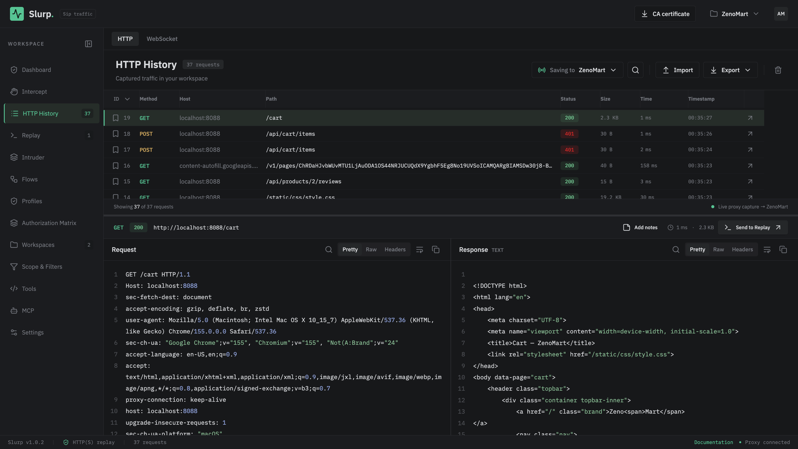

# Slurp

**Sip traffic.**

Slurp is a traffic inspection and API security testing tool built with a Rust proxy and a browser-based interface. Capture HTTP, HTTPS and WebSocket traffic, inspect and replay requests, automate API workflows, and connect AI assistants through MCP.

The standalone executable serves both the web UI and API. No Node.js runtime is required to run a packaged release.



## Features

- **HTTP/2:** negotiated automatically over HTTPS (ALPN) on both the client and upstream sides; WebSocket handshakes stay on HTTP/1.1.
- **HTTP History:** search and filter captured requests, browse large histories with incremental loading and virtual scrolling, bookmark requests, add notes, delete entries, and export JSON or HAR.
- **Intercept:** hold requests and responses for inspection, edit HTTP messages, and forward or drop held traffic. Held items have no automatic expiration.
- **WebSocket:** capture WS/WSS handshakes and bidirectional frames, inspect text or hex payloads, hold frames in Intercept, and send connections to WebSocket Replay.
- **Replay:** edit requests in multiple tabs, import cURL, Postman collections, Bruno `.bru` files and Burp XML exports, use shared variables and after-response scripts, and review previous sends.
- **Flows:** chain API requests into workflows and pass response values between steps.
- **Profiles, Response Diff and Authorization Matrix:** manage account variables, headers and cookies, compare responses, and test access across accounts.
- **Intruder:** substitute payloads with configurable concurrency, rate limits, response matching and saved results.
- **Scan Dashboard:** monitor tasks and findings, automatically audit captured APIs for missing authentication and permissive CORS, compare disclosed PHP releases with PHP2Shell (CVE-2026-109618, CVE-2026-109619), flag HTTP2Shell (CVE-2026-111497) Brotli request-body decoding and React2Shell (CVE-2025-55182) RSC exposure, and passively discover endpoints and suspected credentials in captured JavaScript. Review evidence and pause automatic auditing from the dashboard. Manual scans use reusable Passive/Active profiles, time/rate controls and a coverage catalog. Active scans can follow up on endpoints discovered in JavaScript with hidden-parameter, anonymous-access and parameter checks, and include an OAuth redirect_uri/login-chain check. Captured OAuth authorize requests are also audited automatically for redirect_uri strictness, state/nonce, form_post injection, callback takeover and unverified ID-token emails. Manual scans include WAF/filter bypass payload sets for SQL injection (`sql-bypass`), reflected XSS (`xss-bypass`) and query/form NoSQL bracket operators (`nosql-bypass`). Experimental active modules cover controlled command/code/EL, LDAP/XPath/XML and local-file XXE probes, with intrusive checks explicitly selected in profiles.
- **Scope & Filters:** focus History and Intercept on configured target domains.
- **Utilities:** Base64, URL, HTML and hex encoding/decoding, UUID generation, and JWT decoding.
- **Workspaces:** organize saved traffic, Replay tabs and testing data locally. Export a workspace to a `.slurp` file (optionally redacting secrets and leaving out authentication profiles or Intruder data) and import it on another machine. Import either creates a new workspace or merges into an existing one, and never overwrites existing data.
- **MCP:** let AI clients search and read traffic, run passive and active scans, create and edit Replay requests, rename tabs, and send saved requests.

## Plan

Planned development builds on the current inspection and scan capabilities:

- **Common vulnerability scanning:** expand automated checks for common web and API vulnerabilities, with evidence and verification to reduce false positives.
- **Specialized vulnerability scanning:** add dedicated scan workflows for individual vulnerability classes, with deeper configuration and validation.
- **Template-based scanning:** support reusable scan templates for defining requests, payloads, matchers and verification steps.
- **Analysis plugins:** develop a plugin system for extending Slurp, including JavaScript analysis and endpoint discovery.
- **Parameter discovery:** discover and test additional query, body and header parameters.
- **GraphQL integration:** add GraphQL-aware inspection, request editing, schema exploration and security testing.
- **Remote capture extensions:** forward WebSocket traffic and interception from capture clients, and send Replay through a client.

## Servers with a private CA

Slurp verifies the certificate of every server it connects to and never turns verification off. For an internal
site, a development or staging server, or a network that re-signs TLS with a corporate CA, trust that CA instead:

- **Settings → Trusted upstream CAs → Add CA certificate** (PEM, `.crt` or `.cer`). It takes effect immediately.
- or place PEM files in `~/.slurp/trusted-cas/` (restart, or add through Settings),
- or set `SLURP_UPSTREAM_CA_FILE=/path/ca.pem[,/path/other.pem]` (read-only, listed in Settings),
- or switch on **Also trust this computer's certificate store** (or `SLURP_UPSTREAM_TRUST_SYSTEM=1`) to use the CAs already installed in the operating system.

The trusted CAs apply to the proxy, Replay, Flows, Intruder, Authorization Matrix and scans. A self-signed server
certificate can be trusted the same way. Only add CAs you trust: any certificate they sign is accepted. For a
capture client talking to a server with a private CA, pass `slurp client --ca-cert ca.pem`.

## Remote capture

Run the UI and storage on a server (for example a VPS) and capture on any number of other machines.
Each client proxies traffic locally, with its own CA and its own IP address, and uploads it to the workspace
chosen when the client was created.

On the server (put a TLS reverse proxy such as Caddy or nginx in front; Slurp refuses to listen on a
public address without HTTPS):

```bash
slurp server --bind 127.0.0.1:5174 --public-url https://slurp.example.com
```

Open the printed UI link, go to **Workspaces → Capture clients → Add client**, choose the workspace, and copy
the generated command to the other machine:

```bash
SLURP_CLIENT_TOKEN=slurp_c_… slurp client --server https://slurp.example.com --scope api.example.com,*.example.com
```

If the server's certificate comes from a private CA, add `--ca-cert ca.pem`.

Then point the browser or tool at the client's proxy (`http://127.0.0.1:8888`) and trust the CA it prints.

- A client must say what to upload: `--scope host,*.domain` or `--all`. Traffic outside the scope never leaves the machine.
- `--redact` masks `Authorization`, `Cookie` and token-like header values before upload.
- Tokens are bound to one workspace, can only upload, and can be revoked from the UI. Only their hashes are stored on the server.
- If the server or network is down, traffic is kept in a local spool and uploaded when it returns.
- Clients refuse plain `http://` servers except on this machine (override with `--allow-insecure-http`).
- Uploaded traffic is not scanned by the automatic audits, which run only on traffic captured by a local proxy.
- Not forwarded yet: WebSocket traffic and interception. Replay and scans run on the server, from the server's network.

Anyone holding the UI token can send requests from the server's network, so keep the UI link private.

## How to run

Download or build the standalone release matching your operating system and CPU architecture. For build requirements and packaging instructions, see [BUILD.md](BUILD.md).

On macOS, open the DMG, drag **Slurp.app** into **Applications**, and launch it. You can also run the standalone CLI:

```sh
# macOS / Linux
./slurp
```

```powershell
# Windows PowerShell
.\slurp.exe
```

Slurp starts the proxy and opens the authenticated web UI in your browser. If the browser does not open, use the full URL printed at startup. Use `--no-open` to disable automatic browser opening.

| Component | Default address |
|---|---|
| Web UI | `http://127.0.0.1:5174/dashboard` |
| UI/API server | `http://127.0.0.1:5174` |
| HTTP/HTTPS proxy | `127.0.0.1:8888` |

Saved proxy settings can override the default listener. Change its IP and port under **Settings → Proxy listener** without restarting the backend.

Stop an existing instance before starting another on the same ports. For the CLI, press **Ctrl+C** to stop Slurp; for the macOS app, use **Quit Slurp**. Closing the browser leaves the backend running. When upgrading, launch the new executable by its actual path so an older copy is not started accidentally.

## Capture traffic

1. Start Slurp and open the authenticated startup URL.
2. Select a saved workspace or a temporary session. Temporary history is kept in memory and is lost when Slurp stops.
3. Configure your browser or HTTP client to use `127.0.0.1:8888` as its HTTP/HTTPS proxy, or use the listener address shown in Settings.
4. For HTTPS and WSS, download Slurp's CA certificate from **CA certificate** in the header or **Settings → HTTPS CA certificate**, then install and trust it in the client or its operating system.
5. Browse your target and inspect captured requests in **HTTP History**. Open its **WebSocket** tab for WS/WSS connections and frames.
6. Enable request or response interception in **Intercept** when you need to hold traffic. Right-click a captured request to send it to Replay or copy it as cURL.

Test an HTTPS capture on macOS/Linux:

```sh
curl --proxy http://127.0.0.1:8888 \
  --cacert "$HOME/.slurp/ca.crt" \
  https://httpbin.org/get
```

On Windows PowerShell:

```powershell
curl.exe --proxy http://127.0.0.1:8888 --cacert "$env:USERPROFILE\.slurp\ca.crt" https://httpbin.org/get
```

Some clients bypass proxies for localhost. To capture a local service explicitly:

```sh
curl --noproxy "" --proxy http://127.0.0.1:8888 http://127.0.0.1:8088/
```

### Reverse proxy

When a client cannot be given a proxy at all, run Slurp in front of the server instead: a **reverse proxy** listens on
an address and forwards every request to one fixed upstream, capturing it like any other traffic. Open
**Settings → Reverse proxies**, enter a listen address (for example `127.0.0.1:9000`) and an upstream
(`https://api.example.com`), and change the client's URL to the listener.

```sh
curl http://127.0.0.1:9000/v1/status      # captured, and forwarded to https://api.example.com/v1/status
```

- The upstream is `http://host[:port]` or `https://host[:port]`; the request path and query are kept.
- By default the upstream's own host is sent as `Host`, which virtual hosts and most APIs need. Choose **Keep the client's Host header** to send the address the client used.
- **Serve HTTPS on the listener** terminates TLS with a certificate signed by the Slurp CA for the name the client asks for, so the client must trust the CA. A client that connects by IP address gets a certificate for that address.
- Rules are saved in `~/.slurp/reverse-proxies.json` and start with Slurp; turn one off to free its port. A rule that cannot bind its address shows the error and is not lost.
- Interception, Replay, scans and WebSocket upgrades work as for proxied traffic. Redirects and cookies that name the upstream are passed through unchanged.
- A reverse proxy has no authentication. Keep it on `127.0.0.1` unless the network is trusted. A rule whose upstream is another Slurp reverse proxy listener is refused, so it cannot loop.

### SOCKS5

The proxy port also speaks **SOCKS5** (no authentication, `CONNECT` only), for tools that cannot use an HTTP proxy.
There is nothing to configure: point the client at the same address.

```sh
curl --socks5-hostname 127.0.0.1:8888 --cacert "$HOME/.slurp/ca.crt" https://httpbin.org/get
```

After the SOCKS handshake Slurp looks at the first bytes the client sends:

- **TLS** is decrypted and captured like `CONNECT` (the client still has to trust Slurp's CA). When the client sends an IP address instead of a name, as `--socks5` does with local DNS, Slurp uses the name in the TLS handshake (SNI).
- **Plain HTTP** is captured.
- **Anything else** (SSH, databases, mail, TLS that is not HTTP) is relayed unchanged and is not captured. Protocols where the server speaks first wait about one second before being relayed.

UDP (`UDP ASSOCIATE`, so QUIC/HTTP3 and DNS over SOCKS) and `BIND` are not supported. Certificate-pinned apps still reject Slurp's CA. Like the HTTP proxy, the SOCKS listener has no authentication, so keep it on `127.0.0.1` unless the network is trusted.

Slurp creates its CA and local data under `~/.slurp/` on macOS/Linux or `%USERPROFILE%\.slurp\` on Windows. Keep `ca.key` and `api-token` private. Only install the public `ca.crt` in client trust stores.

## MCP

Connect Claude, Codex, DeepSeek Harness, OpenCode or Antigravity to inspect traffic and work with Replay requests. Keep the Slurp backend running; the AI client launches a separate `slurp mcp` process over **stdio**.

For clients that accept an `mcpServers` configuration:

```json
{
  "mcpServers": {
    "slurp": {
      "command": "slurp",
      "args": ["mcp"]
    }
  }
}
```

Add Slurp's executable directory to the PATH used by your client, or replace `slurp` with its actual absolute path. Use `slurp.exe` on Windows. Client configuration formats differ; follow the [MCP client setup guide](curl-cozy/public/docs/mcp.html) for the appropriate example.

When the MCP process runs as the same OS user as the backend, it automatically reads the management token from `~/.slurp/api-token` on macOS/Linux or `%USERPROFILE%\.slurp\api-token` on Windows. No token needs to be pasted into the configuration. An explicit `SLURP_API_TOKEN` environment variable overrides that file.

For a different API port, use `args: ["mcp", "--api", "http://127.0.0.1:15174"]`. The address is Slurp's REST API; it is not a remote MCP endpoint. Restart the client's MCP connection after changing its binary path or credentials.

Connected assistants can read captured credentials and bodies. `send_replay` sends real requests, and `clear_traffic` deletes history; use your client's tool approval controls accordingly.

The setup guide is also available inside Slurp at **Documentation → MCP client setup**.
