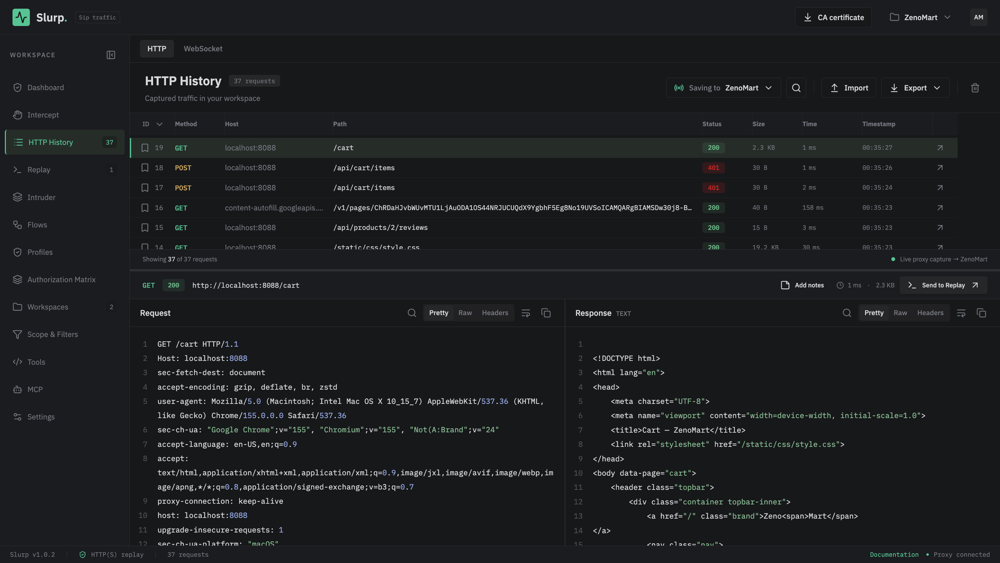

# Slurp

**Sip traffic.**

Slurp is a traffic inspection and API security testing tool built with a Rust proxy and a browser-based interface. Capture HTTP, HTTPS and WebSocket traffic, inspect and replay requests, automate API workflows, and connect AI assistants through MCP.

The standalone executable serves both the web UI and API. No Node.js runtime is required to run a packaged release.



## Features

- **HTTP History:** search and filter captured requests, browse large histories with incremental loading and virtual scrolling, bookmark requests, add notes, delete entries, and export JSON or HAR.
- **Intercept:** hold requests and responses for inspection, edit HTTP messages, and forward or drop held traffic. Held items have no automatic expiration.
- **WebSocket:** capture WS/WSS handshakes and bidirectional frames, inspect text or hex payloads, hold frames in Intercept, and send connections to WebSocket Replay.
- **Replay:** edit requests in multiple tabs, import cURL, Postman collections and Bruno `.bru` files, use shared variables and after-response scripts, and review previous sends.
- **Flows:** chain API requests into workflows and pass response values between steps.
- **Profiles, Response Diff and Authorization Matrix:** manage account variables, headers and cookies, compare responses, and test access across accounts.
- **Intruder:** substitute payloads with configurable concurrency, rate limits, response matching and saved results.
- **Scan Dashboard:** monitor tasks and findings, automatically audit captured APIs for missing authentication and permissive CORS, and passively discover endpoints and suspected credentials in captured JavaScript. Review evidence and pause automatic auditing from the dashboard. Manual scans use reusable Passive/Active profiles, time/rate controls and a coverage catalog. Experimental active modules cover controlled command/code/EL, LDAP/XPath/XML and local-file XXE probes, with intrusive checks explicitly selected in profiles.
- **Scope & Filters:** focus History and Intercept on configured target domains.
- **Utilities:** Base64, URL, HTML and hex encoding/decoding, UUID generation, and JWT decoding.
- **Workspaces:** organize saved traffic, Replay tabs and testing data locally.
- **MCP:** let AI clients search and read traffic, create and edit Replay requests, rename tabs, and send saved requests.

## Plan

Planned development builds on the current inspection and scan capabilities:

- **Common vulnerability scanning:** expand automated checks for common web and API vulnerabilities, with evidence and verification to reduce false positives.
- **Specialized vulnerability scanning:** add dedicated scan workflows for individual vulnerability classes, with deeper configuration and validation.
- **Template-based scanning:** support reusable scan templates for defining requests, payloads, matchers and verification steps.
- **Burp project import:** add support for importing `.burp` project files into Slurp.
- **Workspace export/import:** export and import workspaces as `.slurp` files.
- **Analysis plugins:** develop a plugin system for extending Slurp, including JavaScript analysis and endpoint discovery.
- **Parameter discovery:** discover and test additional query, body and header parameters.
- **GraphQL integration:** add GraphQL-aware inspection, request editing, schema exploration and security testing.
- **Client–server architecture:** support multiple clients connected to a shared server for centralized traffic collection, storage and management.

## How to run

Download or build the standalone release matching your operating system and CPU architecture. For build requirements and packaging instructions, see [BUILD.md](BUILD.md).

On macOS, open the DMG, drag **Slurp.app** into **Applications**, and launch it. You can also run the standalone CLI:

```sh
# macOS / Linux
./slurp
```

```powershell
# Windows PowerShell
.\slurp.exe
```

Slurp starts the proxy and opens the authenticated web UI in your browser. If the browser does not open, use the full URL printed at startup. Use `--no-open` to disable automatic browser opening.

| Component | Default address |
|---|---|
| Web UI | `http://127.0.0.1:5174/dashboard` |
| UI/API server | `http://127.0.0.1:5174` |
| HTTP/HTTPS proxy | `127.0.0.1:8888` |

Saved proxy settings can override the default listener. Change its IP and port under **Settings → Proxy listener** without restarting the backend.

Stop an existing instance before starting another on the same ports. For the CLI, press **Ctrl+C** to stop Slurp; for the macOS app, use **Quit Slurp**. Closing the browser leaves the backend running. When upgrading, launch the new executable by its actual path so an older copy is not started accidentally.

## Capture traffic

1. Start Slurp and open the authenticated startup URL.
2. Select a saved workspace or a temporary session. Temporary history is kept in memory and is lost when Slurp stops.
3. Configure your browser or HTTP client to use `127.0.0.1:8888` as its HTTP/HTTPS proxy, or use the listener address shown in Settings.
4. For HTTPS and WSS, download Slurp's CA certificate from **CA certificate** in the header or **Settings → HTTPS CA certificate**, then install and trust it in the client or its operating system.
5. Browse your target and inspect captured requests in **HTTP History**. Open its **WebSocket** tab for WS/WSS connections and frames.
6. Enable request or response interception in **Intercept** when you need to hold traffic. Right-click a captured request to send it to Replay or copy it as cURL.

Test an HTTPS capture on macOS/Linux:

```sh
curl --proxy http://127.0.0.1:8888 \
  --cacert "$HOME/.slurp/ca.crt" \
  https://httpbin.org/get
```

On Windows PowerShell:

```powershell
curl.exe --proxy http://127.0.0.1:8888 --cacert "$env:USERPROFILE\.slurp\ca.crt" https://httpbin.org/get
```

Some clients bypass proxies for localhost. To capture a local service explicitly:

```sh
curl --noproxy "" --proxy http://127.0.0.1:8888 http://127.0.0.1:8088/
```

Slurp creates its CA and local data under `~/.slurp/` on macOS/Linux or `%USERPROFILE%\.slurp\` on Windows. Keep `ca.key` and `api-token` private. Only install the public `ca.crt` in client trust stores.

## MCP

Connect Claude, Codex, DeepSeek Harness, OpenCode or Antigravity to inspect traffic and work with Replay requests. Keep the Slurp backend running; the AI client launches a separate `slurp mcp` process over **stdio**.

For clients that accept an `mcpServers` configuration:

```json
{
  "mcpServers": {
    "slurp": {
      "command": "slurp",
      "args": ["mcp"]
    }
  }
}
```

Add Slurp's executable directory to the PATH used by your client, or replace `slurp` with its actual absolute path. Use `slurp.exe` on Windows. Client configuration formats differ; follow the [MCP client setup guide](curl-cozy/public/docs/mcp.html) for the appropriate example.

When the MCP process runs as the same OS user as the backend, it automatically reads the management token from `~/.slurp/api-token` on macOS/Linux or `%USERPROFILE%\.slurp\api-token` on Windows. No token needs to be pasted into the configuration. An explicit `SLURP_API_TOKEN` environment variable overrides that file.

For a different API port, use `args: ["mcp", "--api", "http://127.0.0.1:15174"]`. The address is Slurp's REST API; it is not a remote MCP endpoint. Restart the client's MCP connection after changing its binary path or credentials.

Connected assistants can read captured credentials and bodies. `send_replay` sends real requests, and `clear_traffic` deletes history; use your client's tool approval controls accordingly.

The setup guide is also available inside Slurp at **Documentation → MCP client setup**.
